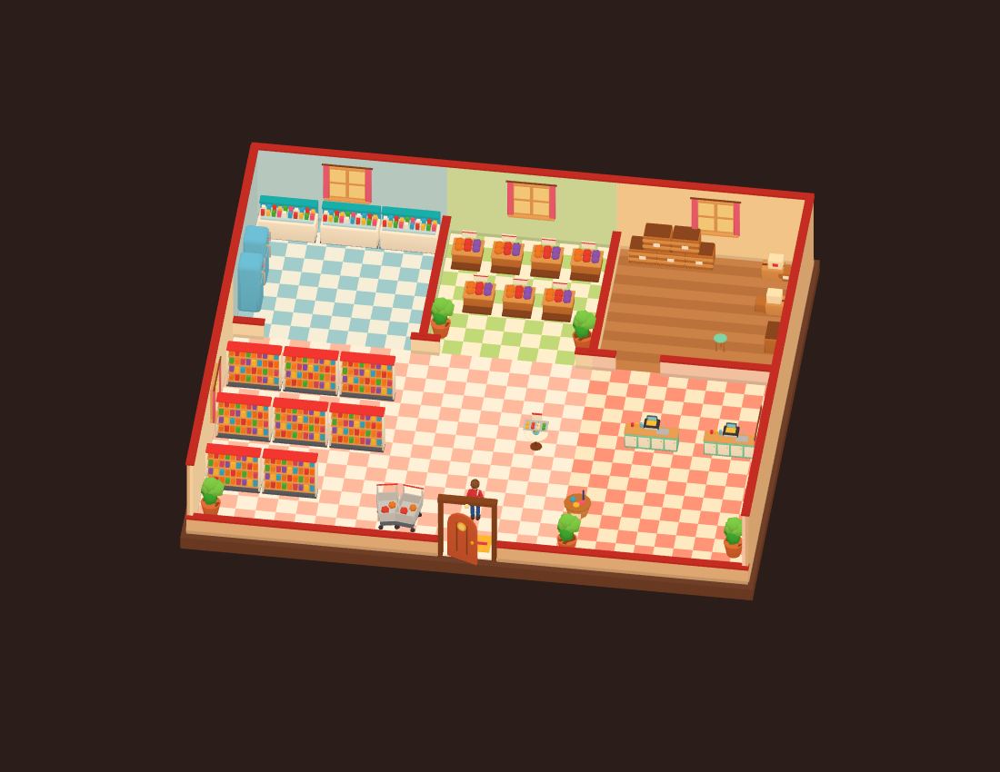

# The village supermarket: story and interior proposal

Status: **design and reusable interior only**, 2026-10-12. The user explicitly chose this scope. There is no buildable supermarket, shop revenue, new chapter gate or save record in this update. Its room is marked `available: false`; it cannot appear as a live Explore destination.

## Why this fits Hollowbrook

The farm already supplies households, the market, company requests, hotel breakfasts and the co-operative. A supermarket can make those relationships visible: the player walks past goods they recognise, reads a neighbour's request and helps decide what goes on the next shelf. Keep the mood of a small village shop, with wooden baskets, warm red trim, colourful food and handmade labels.

This is an optional branch of the village growth plan's shop stage (proposed levels 14–18), not a replacement for the existing chapters 1–20. Introduce it after a working market and school and at least two working food workshops. Show its idea earlier as an optional conversation; actual eligibility and construction prices must be checked against the current economy before implementation. Never insert a new mandatory gate into old saved chapter progress.

The source is the user's `3d_farmer_fish_sell` / Willowmere repository, commit `9ca557bed3ebc6c36906e2eb84582aef23f4375b`. Reuse its supermarket room and props, adapting the story to Hollowbrook's existing cast. Do not import Willowmere's shopkeeper identities, schedules, rewards or its blanket 25% sale bonus.

## Story arc: The shop we fill together / Siêu thị của làng mình

| Beat | Player effort | Happy response and permanent change |
|---|---|---|
| A shelf for our neighbours | Inspect the empty shop notice after the branch unlocks | Granny Maple (`ellis`) suggests a place for the village's own food. A plan is saved in Today, with one next action and a way to find materials. |
| Make it our own | Repair shelves and choose one initial section: garden, bakery, or pond | Chip (`minh`) puts up a handmade sign. The chosen section gains colour and stocked props. Every route reaches the same opening; the other sections remain available later. |
| Our first basket | Explicitly supply a small, attainable request from that section | Honey (`lan`) thanks the farmer. The opening photo goes in the album; the sign changes from “Coming soon” to the village shop name. No real-time deadline. |
| A little taste of something new | Supply a second, different section when ready | A tasting-table conversation connects two products, such as bread and fruit juice. Villagers suggest variety based on actual demand and inventory. |
| Room for everyone | Complete all three section introductions, at the player's pace | Sunny (`pip`) discovers a handmade thank-you card behind a shelf. The card is a one-time memory, not a repeatable money dispenser. The shop's requests continue without repeating opening dialogue. |

Use existing localized identities through `{person:<id>:display}` in implementation. These are draft lines, not strings already registered in the live story:

| Speaker / state | English draft | Vietnamese draft |
|---|---|---|
| Maple / idea | “A few shelves, dear. Enough for everyone to find a little something grown close to home.” | “Chỉ cần vài chiếc kệ thôi, cháu à. Để bà con ghé vào là tìm được chút quà do làng mình làm ra.” |
| Chip / repair | “A sturdy shelf. Now we just need something delicious to put on it.” | “Kệ chắc rồi nhé. Giờ chỉ còn chờ món ngon của cháu lên kệ thôi.” |
| Honey / surplus bread, an open cake request, cake recipe unlocked | “The bread shelf is lovely and full. There is a cake on today's wish list, if you feel like baking something different.” | “Kệ bánh mì đầy thơm phức rồi. Hôm nay có người nhắn cô muốn mua bánh ngọt đấy, cháu thích thì mình đổi món nhé.” |
| Honey / blocked ingredients | “We have the recipe. Let's find the last ingredient together.” | “Có công thức rồi, cô cháu mình tìm nốt nguyên liệu còn thiếu nhé.” |
| Sunny / first basket | “Our food is in someone else's basket now! I wonder what they will make.” | “Đồ nhà mình nằm trong giỏ của cô chú rồi kìa! Không biết cô chú sẽ nấu món gì nhỉ?” |
| Sunny / discovery | “There is a thank-you card behind the shelf! Can we keep it in our album?” | “Có tấm thiệp cảm ơn sau kệ này! Mình cất vào album nhé?” |

## Interior contract already prepared

Lazy data: `public/assets/models/interior-supermarket.json`, generated from `src/content/civic-plans.mjs`.
Furniture kits: packed `cottage-furniture.glb` and `facility-props.glb`. Current envelope: 19.6 × 16.8 m; front door at local `[0, 0, 8.4]`; arrival `[0, 0, 6.4]`; exit stand `[0, 0, 7.6]`; avatar radius 0.3 m. These are interior metres, independent of the later outdoor footprint.

| Room | Visible objects | Stable interaction ID | Prepared now | Later shop behavior |
|---|---|---|---|---|
| Fresh section | Produce bins and plants | `supermarket_fresh` | Short observation | Show the section's current request and a direct “Where to get it” route |
| Cold section | Chillers and fridges | — | Scenery | Milk/fish stock only when the corresponding section is introduced; no spoilage |
| Shop floor | Food shelves, baskets and carts | — | Scenery | Stocked appearances follow delivered goods, not passive inventory depletion |
| Checkout | Counter and register | `supermarket_checkout` | Short observation | Explicit review of quantity, available/free stock and payment, then confirm delivery |
| Tasting table | Table and sample tray | `supermarket_sample` | Short observation | Optional changing dialogue; no unlimited reward on every tap |
| Back room | Crates and boxes | — | Scenery | Optional larger-project repair; everyday shop play costs no energy |
| Front door | Door and mat | `interior_exit` | Navigation metadata | Leave at the actual outdoor shop door, with the existing safe-return fallback |

The build checks every interaction's reachable walking position. The room is ready for a later renderer preview; no map building, construction icon, exterior placement or shop opening has been added. Exterior art/footprint and stock-state variants need a separate asset contract when implementation is authorized.

## Economy and smart guidance requirements for the next slice

- Keep ordinary barn selling, market trucks and the existing lake/plaza shop baskets useful. The supermarket should buy a limited requested basket at a clearly displayed premium; do not give an unlimited global multiplier. Initial balancing candidate: at most one active basket, 6–12 units across 1–2 unlocked goods, 20–30% above base value. These are proposals, not live prices.
- Derive eligible goods from actual working producers, unlocked recipes and reachable sources. Do not request ginseng, cake or fish just because a level threshold was crossed. Every missing ingredient opens the existing source help and returns to the same order.
- The player chooses what to supply. Show company/quest reserves and free quantities before confirmation. Automatic truck drivers and workshop hands must not consume accepted shop reservations. A manual sale must explicitly state which reservation it would affect, or refuse it before mutating inventory.
- Preserve the offered goods, quantities and price in a save. Do not reroll on language change, reload, clock rollback or leaving the interior. No expiry penalty and no stock loss while away. Any optional refresh must have a deliberate button and stable rules.
- Guidance has four priorities: an actionable blocker, a useful sale/production suggestion, an optional activity, then a celebration. Show only one relevant suggestion at a time. Bread surplus alone must never produce a cake suggestion unless there is a real cake request and the recipe is available.
- Give construction/first-basket/discovery rewards once, keyed by stable IDs. Prefer a sign, stocked shelf, photo and letter. Any coin amount must be approved by the progression simulation; avoid an unearned 1,000-coin windfall.
- Optional larger repairs may use project energy. Cooking, deliveries, walking, shopping and reading dialogue stay free of energy. Empty shelves do not shame the player.
- Put the entry in the building's sheet and Explore, not a new permanent HUD icon. Today retains missed news; the existing badge is the only unread counter. Calm gold marks a completed milestone; reduced-motion mode removes sparkle movement.

Proposed isolated save shape: `supermarket: { version: 1, introducedAt, openedAt, sections, request, completed, memories, read }`. Normalize malformed records; keep held controls, room pose and routes transient. Reserve action names `introduceSupermarket`, `restoreShopSection`, `acceptShopBasket`, `deliverShopBasket`, `readShopMemory`; implementation must validate costs, quantities, prerequisites and repetition before changes.

## Acceptance before a playable release

1. Verify the proposed unlock and build cost with casual, steady and keen progression simulations; keep school pace unchanged.
2. Tests for atomic refusals, reserves shared with company/trucks/helpers, duplicate delivery, overflow, save imports, profile isolation, clock rollback and all four language editions.
3. Branch-specific conversations before/after each beat; localized names and Vietnamese speaker pronouns; no repeated first-opening celebration.
4. Match exterior door orientation and footprint; enter/exit in all rotations; accessible 44 px buttons at 390 px, short landscape and desktop.
5. Keep all shop code and assets lazy, preserve first-load budget, and check 120 draws / 300k triangles at every zoom.
6. Run the full rules, pace and browser suites; review the playable branch before merging and deploying.

## Other reference interiors checked

Hospital, police, company, school, Moss's barn and bakery have been adapted for buildings already in Hollowbrook. Vale's timber/tool workshop also exists in the source but has no matching standalone Hollowbrook building yet; leave it for a scoped workshop feature. No dedicated dairy, feed-mill or goat-barn room was found in that reference's facility plans. Do not relabel the supermarket or a bedroom as one of those production rooms.
